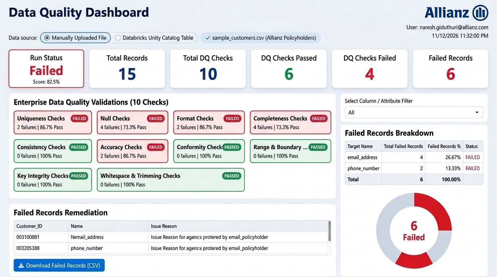

# Project Allianz: Data Quality Dashboard

A white corporate Data Quality Dashboard built in **Python (Streamlit)** for **Project Allianz**, featuring the corporate typography from the initial reference, enlarged executive KPI cards, 10 enterprise validation checks, and a simple 1-click **Failed Records Remediation** feature.



---

## 🏛️ Executive Header & Structure

- **Left Side**:
  - Title: `Data Quality Dashboard` (clean title with no subtitle or notes)
- **Right Side**:
  - Brand: `Allianz` (with Allianz logo mark)
  - User: Logged-in user from Databricks OBO (`naresh.giduthuri@allianz.com`)
  - Timestamp: Live current time directly under user name (`11/12/2026 11:32:00 PM`)

---

## 🚀 Key Implementation Details

1. **Exact Typography Matching the Reference**:
   - Replaced all monospace fonts with the clean, bold corporate sans-serif typography matching the manager's screenshot (`Segoe UI`, `Plus Jakarta Sans`, `Arial`).
   - Numbers and cards are rendered in bold proportional sans-serif with high visual contrast.

2. **Simple Remediation (Single Focused Feature)**:
   - Simplified the remediation section to a single purpose: **downloading failed records**.
   - Features a clean preview of defective rows with specific error tags and a prominent **`[ 📥 Download Failed Records (CSV) ]`** button.

3. **Enlarged Executive KPI Scorecards**:
   - Top row features 6 prominent white cards: `Run Status`, `Total Records`, `Total DQ Checks`, `DQ Checks Passed`, `DQ Checks Failed`, and `Failed Records`.

4. **10 Enterprise Validation Checks (Strict Green / Red Rule)**:
   - **🟢 GREEN**: 100% Passed (0 failures).
   - **🔴 RED**: Failed ($>0$ failures).
   - 1. Uniqueness Checks
   - 2. Null Checks
   - 3. Format Checks
   - 4. Completeness Checks
   - 5. Consistency Checks
   - 6. Accuracy Checks
   - 7. Conformity Checks (Dirty String / Placeholders)
   - 8. Range & Boundary Checks
   - 9. Key Integrity Checks
   - 10. Whitespace & Trimming Checks

5. **Dynamic Breakdown & Donut Chart**:
   - Filter dropdown (`Select Column / Attribute Filter -> [ All v ]`) dynamically updates both the breakdown table and the donut chart.

---

## 📁 Repository Structure (All Flat in Parent Directory)

```
databricksapp_dq_dashboard/
├── app.py                             # Main Streamlit dashboard application
├── obo_auth.py                        # Databricks OBO authentication module
├── data_service.py                    # 10 Core DQ validations + Remediation engine
├── styles.py                          # White corporate CSS styling matching reference font
├── sample_customers.csv               # Sample test CSV file
├── allianz_white_dashboard_preview.jpg# White dashboard UI screenshot
├── app.yaml                           # Databricks Apps configuration
├── requirements.txt                   # Dependencies
└── README.md                          # Documentation
```

---

## 💻 Running Locally

```bash
# Install dependencies
pip install -r requirements.txt

# Run the Streamlit dashboard
streamlit run app.py
```
Open `http://localhost:8501`. Toggle between **"Manually Uploaded File"** and **"Databricks Unity Catalog Table"** to evaluate datasets.
